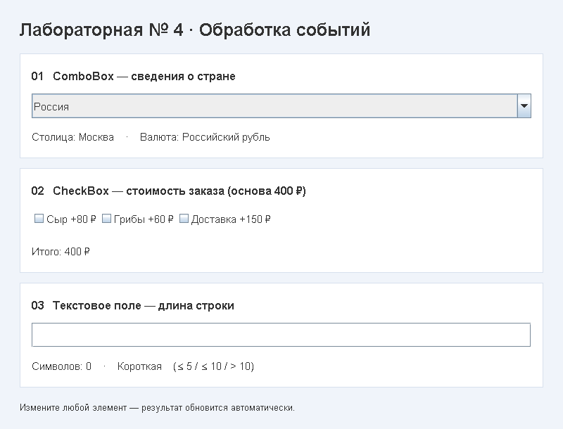

# Лабораторная работа № 4

## Реализация

| Задание | Пример | Обработчик |
| --- | --- | --- |
| Изменение ComboBox | Выбор России, Казахстана или Японии обновляет столицу и валюту | `ActionListener` |
| Выбор / снятие CheckBox | Сыр, грибы и доставка изменяют стоимость заказа | `ItemListener` |
| Нажатие клавиш в текстовом поле | При вводе отображаются длина и категория строки | `KeyAdapter.keyReleased` |

Дополнительный `DocumentListener` обновляет результат также при вставке, удалении через меню и изменении текста из кода. Внизу окна отображается последнее обработанное событие.

Классификация строки: до 5 символов включительно — **короткая**, от 6 до 10 — **нормальная**, больше 10 — **длинная**. Пустая строка считается короткой.
Стоимость заказа: основа **400 ₽**, сыр **80 ₽**, грибы **60 ₽**, доставка **150 ₽**. 

## Структура 

- `src/DemoModel.java` — модель: сведения о странах, стоимость, длина и классификация строки.
- `src/DemoView.java` — представление: элементы Swing и их размещение.
- `src/DemoController.java` — контроллер: регистрация слушателей и обновление результатов.
- `src/Main.java` — запуск окна в потоке обработки событий Swing (EDT).
- `demo.gif` — зацикленная демонстрация для GitHub.

